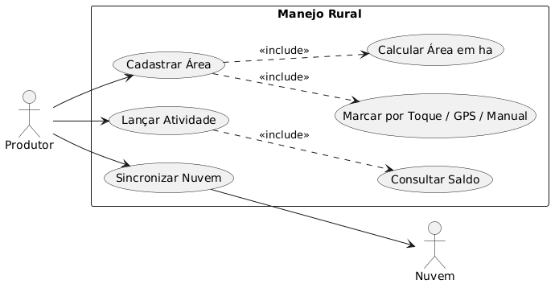
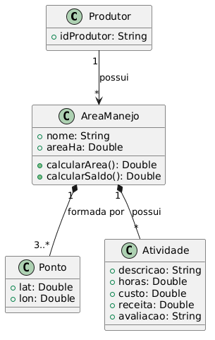
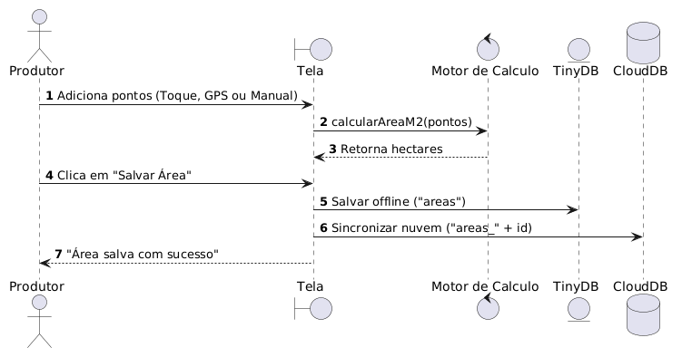
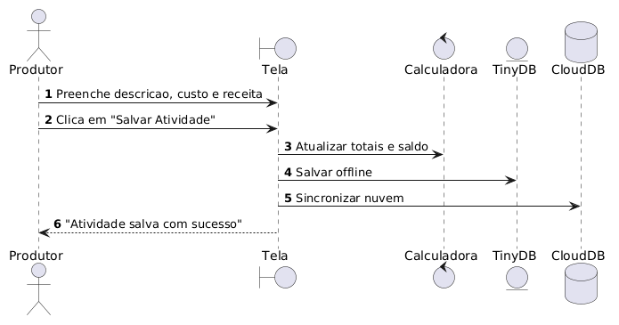
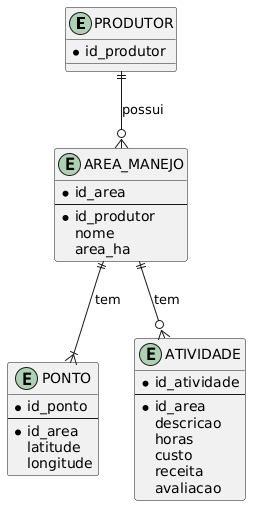

# Documentação do Projeto e Relatório Técnico

**Sistema:** Manejo Rural MVP  
**Plataforma:** Android / MIT App Inventor  

---

# PARTE 1 — PROJETO DO SOFTWARE

## 1. Descrição do Software
Aplicativo móvel para produtores rurais delimitarem áreas de manejo no mapa e registrarem atividades agrícolas com controle de custos e receitas. Funciona 100% offline no campo e sincroniza com a nuvem quando há internet.

---

## 2. Requisitos

### Requisitos Funcionais (RF)
* **RF01 — Definir área com 3+ pontos:** Exige no mínimo 3 coordenadas para fechar o polígono.
* **RF02 — Toque no mapa:** Adiciona pontos tocando na tela.
* **RF03 — Coordenadas por GPS:** Adiciona a coordenada atual pelo sensor GPS do aparelho.
* **RF04 — Coordenadas manuais:** Permite digitar latitude e longitude.
* **RF05 — Calcular área (triangulação):** Calcula a área em hectares via Fórmula de Gauss (Shoelace), que decompõe o polígono em triângulos.
* **RF06 — Visualizar mapa:** Exibe o polígono desenhado sobre o mapa.
* **RF07 — Gerenciar áreas:** Lista, edita e exclui áreas cadastradas.
* **RF08 — Registrar atividades:** Cadastra tarefas agrícolas vinculadas a uma área.
* **RF09 — Dados da atividade:** Registra descrição, horas estimadas, custo e receita.
* **RF10 — Avaliar atividade:** Registra avaliação (*Positiva, Neutra, Negativa*).
* **RF11 — Gerenciar atividades:** Lista, edita e exclui atividades.
* **RF12 — Balanço financeiro:** Calcula automaticamente Custo Total, Receita Total e Saldo da área.
* **RF13 — Funcionamento offline:** Salva todos os dados no aparelho (`TinyDB`).
* **RF14 — Sincronização em nuvem:** Envia e recebe dados da nuvem (`CloudDB`).

### Requisitos Não Funcionais (RNF)
* **RNF01 — Usabilidade:** Interface simples, em painéis na mesma tela, botões grandes e legíveis no campo.
* **RNF02 — Economia de bateria:** Leitura de GPS sob demanda (não fica rastreando o tempo todo).
* **RNF03 — Concorrência e escala:** Cada aparelho possui um ID único (`produtor_XXXXXX`), gravando em sua própria tag na nuvem para não sobrescrever dados de outros usuários.

---

## 3. Casos de Uso

### 3.1 Diagrama de Casos de Uso

### 3.2 Descrição dos Casos de Uso Principais
* **Cadastrar Área:** O produtor insere o nome, marca 3 ou mais pontos (no mapa, via GPS ou manualmente), o app desenha o polígono, calcula os hectares e salva localmente e na nuvem.
* **Lançar Atividade:** O produtor seleciona uma área, informa descrição, tempo, custo, receita e avaliação. O app salva e atualiza o saldo da área.

---

## 4. Diagrama de Classes

---

## 5. Diagramas de Sequência

### 5.1 Sequência: Marcar Área e Salvar

### 5.2 Sequência: Lançar Atividade

---

## 6. Modelo Entidade-Relacionamento (ER)

---

# PARTE 2 — RELATÓRIO TÉCNICO

## 1. Tecnologias Utilizadas
* **Plataforma:** MIT App Inventor (Android).
* **Mapas:** OpenStreetMap (`Map` nativo).
* **GPS:** Sensor de localização do celular (`LocationSensor`).
* **Banco Local:** `TinyDB` (armazenamento offline no próprio aparelho).
* **Banco Remoto:** `CloudDB` (nuvem Redis para sincronização).

---

## 2. Justificativa das Escolhas

### Por que Android / App Inventor?
* Permite testar direto no celular do produtor, usando o GPS real no campo.
* Não exige licenças de softwares caros de agrimensura.

### Por que TinyDB + CloudDB?
* **TinyDB (Offline-First):** No campo muitas vezes não há sinal de internet. O TinyDB garante que o produtor consiga marcar áreas, salvar atividades e ver o saldo sem depender de rede.
* **CloudDB (Nuvem):** Quando o celular conecta na internet (Wi-Fi ou 4G), os dados são enviados para a nuvem como backup e sincronização.

---

## 3. Como a Solução Atende à Demanda

### Como a área é calculada por triangulação?
* O app usa a **Fórmula de Gauss (Shoelace)**:
  1. Converte a latitude e longitude dos pontos em metros.
  2. Multiplica os pontos consecutivos em cruz e soma as áreas.
* **Explicação simples:** A fórmula de Gauss matematicamente divide o polígono em vários triângulos a partir do centro e soma a área de todos eles. Isso é exatamente a triangulação pedida no projeto.

### Como atende à eficiência de bateria e recursos?
* **Bateria:** O GPS não fica ligado o tempo todo. Ele só busca o sinal dos satélites quando o usuário clica no botão de GPS.
* **Armazenamento e Rede:** As áreas e atividades ficam salvas localmente e só sobem para a nuvem quando necessário, sem tráfego inútil de dados.

### Como funciona a concorrência e escala com múltiplos usuários?
* Cada celular gera um código único no primeiro uso (ex: `produtor_123456`).
* Na nuvem, os dados são salvos na tag `areas_produtor_123456`.
* Dessa forma, mil produtores podem usar o aplicativo ao mesmo tempo sem que um sobrescreva a área do outro.
