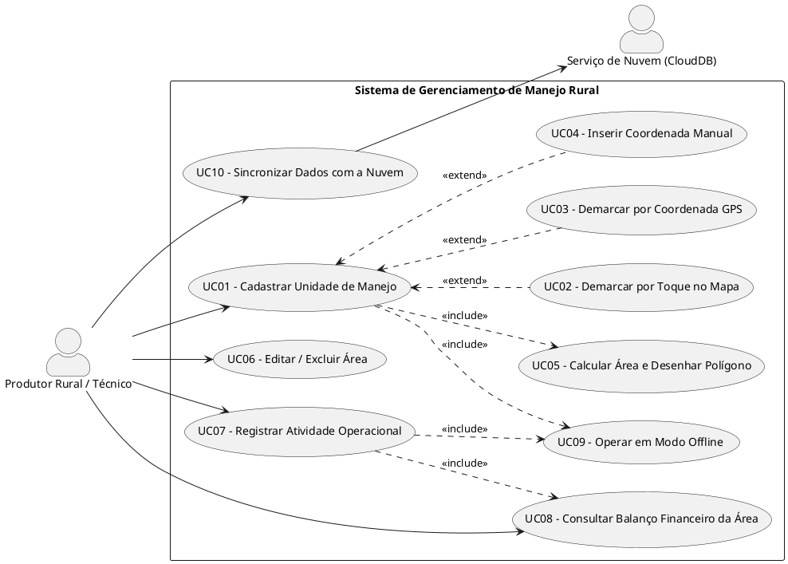
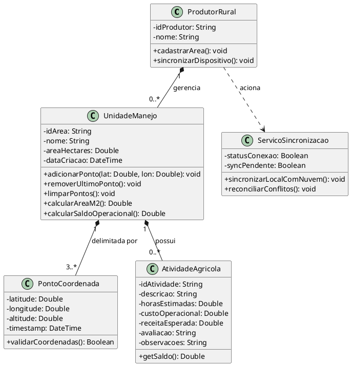
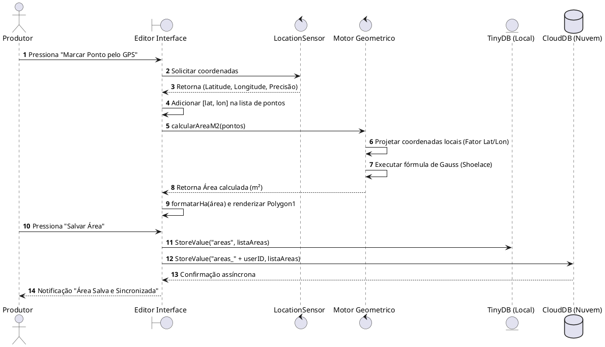
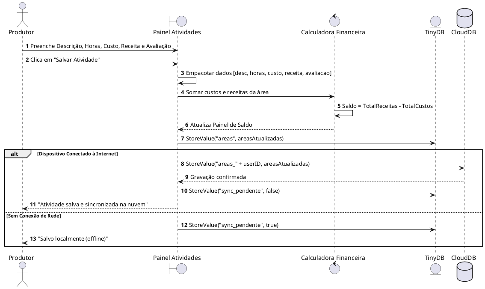
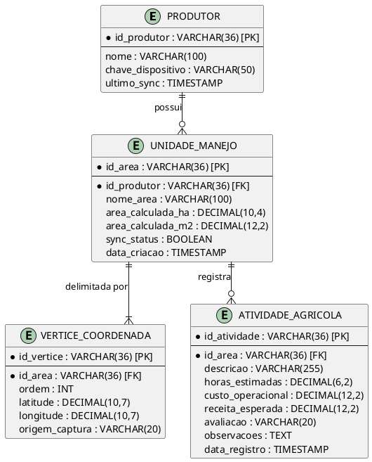

# Documentação de Projeto de Software e Relatório Técnico

**Sistema:** Sistema de Delimitação de Áreas de Manejo Rural e Gestão Operacional  
**Ambiente:** Mobile / Edge Computing (Android)  
**Versão do Documento:** 1.0  

---

# PARTE 1 — PROJETO DO SOFTWARE

## 1. Descrição do Software

O **Sistema de Delimitação de Áreas de Manejo Rural e Gestão Operacional** é uma solução de computação móvel desenvolvida para o contexto do agronegócio e agricultura familiar, com foco na arquitetura *Offline-First*. 

A aplicação tem como finalidade primordial permitir que produtores e técnicos rurais realizem a demarcação georreferenciada de talhões e parcelas de terra utilizando o dispositivo móvel em campo. O sistema oferece três modalidades independentes de entrada de coordenadas (toque interativo sobre mapa, rastreamento contínuo por sensores de satélite GPS/GNSS do aparelho e alimentação manual de pares de latitude e longitude). A partir de três ou mais pontos, o software realiza o fechamento geométrico do polígono e calcula de forma analítica e em tempo real a área de manejo delimitada em hectares ($ha$).

Associada a cada unidade territorial mapeada, a solução disponibiliza um módulo de gestão de atividades rurais (plantio, adubação, pulverização, monitoramento, colheita), viabilizando o apontamento de tempo operacional estimado em horas, composição de custos de insumos e maquinário, receitas esperadas e avaliação qualitativa de desempenho. Todas as transações são persistidas localmente no armazenamento do aparelho, operando com total autonomia sem conexão à internet, e contam com rotinas de sincronização bidirecional na nuvem e isolamento por inquilino (*multi-tenant*), prevenindo colisões de dados em cenários concorrentes.

---

## 2. Definição de Requisitos e Rastreabilidade

### 2.1 Requisitos Funcionais (RF)

| Identificador | Requisito | Descrição Técnica e Atendimento |
|---|---|---|
| **RF01** | Delimitação de Unidade de Manejo | O sistema valida e exige um conjunto mínimo de 3 coordenadas para habilitar o fechamento do polígono territorial e a consolidação do talhão com nome identificador. |
| **RF02** | Entrada por Toque no Mapa | O operador visualiza a base cartográfica OpenStreetMap e insere vértices geográficos ao tocar diretamente nas coordenadas de interesse (`Map1.TapAtPoint`). |
| **RF03** | Entrada por Geolocalização (GPS) | O sistema obtém as coordenadas geodésicas instantâneas do operador via satélite por meio de sensor de hardware sob demanda (`LocationSensor1`), permitindo o caminhamento pelo perímetro. |
| **RF04** | Entrada Manual de Coordenadas | O operador digita pares de latitude e longitude em graus decimais com validação estrita de limites geográficos ($-90 \le lat \le 90$ e $-180 \le lon \le 180$). |
| **RF05** | Cálculo de Área por Triangulação | Execução da Fórmula de Gauss (*Shoelace Formula*) com correção trigonométrica métrica local baseada na latitude média do terreno, equivalendo analiticamente à soma de triângulos planos orientados. |
| **RF06** | Exibição Cartográfica da Área | Renderização vetorial dinâmica do polígono delimitador sobre o mapa, com contorno espesso e preenchimento semitransparente em tempo real (`Polygon1`). |
| **RF07** | Gestão de Unidades de Manejo | Interface para listagem das áreas cadastradas, seleção para exibição de detalhes, edição de geometria e exclusão com expurgo em cascata. |
| **RF08** | Registro de Atividades Operacionais | Módulo acoplado a cada área para lançamento de tarefas agrícolas categorizadas. |
| **RF09** | Apontamento de Esforço e Finanças | Coleta estruturada de tempo operacional (horas), custo de insumos/maquinário/mão de obra ($R\$$) e receita financeira projetada ($R\$$). |
| **RF10** | Avaliação da Atividade | Coleta de parâmetro qualitativo (*Positiva*, *Neutra*, *Negativa*) e campo para observações operacionais. |
| **RF11** | Gestão do Ciclo de Atividades | Listagem cronológica das operações da área, edição de registros anteriores e exclusão individual. |
| **RF12** | Consolidação Financeira | Apuração automatizada e instantânea do custo total acumulado, receita total e saldo operacional da unidade de manejo. |
| **RF13** | Persistência Local (*Offline-First*) | Todos os registros são gravados em memória física não volátil do terminal (`TinyDB`), viabilizando operação irrestrita em áreas sem conectividade. |
| **RF14** | Sincronização em Nuvem | Transmissão e reconciliação dos registros locais com banco de dados remoto baseado em chave-valor em nuvem (`CloudDB`), disparada manualmente ou ao salvar alterações com rede ativa. |

### 2.2 Requisitos Não Funcionais (RNF)

| Identificador | Requisito | Mecanismo de Atendimento |
|---|---|---|
| **RNF01** | Eficiência de Bateria e Sensores | O rádio do chip GPS não opera em modo contínuo de varredura (*polling* desabilitado; `TimeInterval: 60s`, `DistanceInterval: 10m`). A leitura de alta precisão é invocada sob demanda do operador. |
| **RNF02** | Eficiência de Armazenamento e Processamento | O algoritmo de cálculo geométrico possui complexidade de tempo linear $O(N)$, sendo executado sem atrasos perceptíveis. Estrutura de dados serializada em vetores compactos. |
| **RNF03** | Usabilidade e Operação no Campo | Arquitetura de interface baseada em *Virtual Screens* e padrão *AgroTech/Material Design*, com cartões de contraste nítido, botões ampliados com cantos arredondados e diferenciação semântica de cores. |
| **RNF04** | Escalabilidade e Concorrência Global | Cada terminal móvel gera e preserva um identificador aleatório de partição única (`userID = produtor_XXXXXX`). As gravações na nuvem utilizam chaves com *namespace* exclusivo (`areas_<userID>`), evitando sobreposição de registros entre operadores concorrentes. |
| **RNF05** | Integridade e Resiliência | Controle de pendência de sincronização local (`sync_pendente`) que garante que dados cadastrados offline não sejam descartados ou perdidos ao reiniciar o aplicativo. |

---

## 3. Casos de Uso

### 3.1 Diagrama de Casos de Uso (PlantUML)

Copie e cole o código abaixo no [PlantText](https://www.planttext.com/):

### 3.2 Especificação Detalhada dos Casos de Uso Principais

#### UC01 — Cadastrar Unidade de Manejo
* **Ator Principal:** Produtor Rural.
* **Pré-condições:** O aplicativo deve estar aberto no *PainelLista*.
* **Fluxo Principal:**
  1. O produtor clica em "Nova Área de Manejo".
  2. O sistema exibe o *PainelEditor* com o mapa e o card de métricas zerado.
  3. O produtor informa o nome da área (ex: "Talhão Soja 01").
  4. O produtor adiciona vértices usando toque no mapa, GPS ou entrada manual (mínimo de 3 pontos).
  5. O sistema desenha o polígono no mapa e calcula a área em hectares instantaneamente.
  6. O produtor clica em "Salvar Área".
  7. O sistema grava os dados localmente no `TinyDB`, dispara a rotina de sincronização em nuvem e retorna à lista.
* **Fluxos Alternativos:**
  * *4a. Quantidade de pontos inferior a 3:* O sistema notifica o usuário exigindo o número mínimo de vértices para viabilizar o polígono.
  * *4b. Nome não informado:* O sistema emite alerta solicitando a identificação da área.

#### UC07 — Registrar Atividade na Área
* **Ator Principal:** Produtor Rural.
* **Pré-condições:** A unidade de manejo deve estar selecionada.
* **Fluxo Principal:**
  1. O produtor acessa o painel de atividades da área selecionada.
  2. Informa descrição, horas estimadas, custo em reais, receita esperada e avaliação (*Positiva, Neutra, Negativa*).
  3. Clica em "Salvar Atividade".
  4. O sistema recalcula o Custo Total, Receita Total e Saldo Operacional da área.
  5. Atualiza a lista no terminal e agenda envio à nuvem.

---

## 4. Diagrama de Classes (PlantUML)

O modelo estrutural conceitual orienta a lógica relacional e de domínio encapsulada no sistema:

---

## 5. Diagramas de Sequência (PlantUML)

### 5.1 Sequência: Cadastro de Ponto GPS e Cálculo de Área

### 5.2 Sequência: Registro de Atividade e Atualização Financeira

---

## 6. Modelo Entidade-Relacionamento (ER)

### 6.1 Diagrama Entidade-Relacionamento (PlantUML)

### 6.2 Dicionário de Dados do Modelo

1. **PRODUTOR:** Tabela/entidade central de controle de inquilino.
   * `id_produtor`: Chave primária alfanumérica única (`userID`).
   * `chave_dispositivo`: Identificador de instalação local para amarração de sessão.
2. **UNIDADE_MANEJO:** Registro do talhão agrícola.
   * `id_area`: Identificador único da área territorial.
   * `nome_area`: Nome atribuído pelo operador (ex: Talhão Norte).
   * `area_calculada_ha`: Valor da área processada em hectares com 2 a 4 casas decimais.
3. **VERTICE_COORDENADA:** Conjunto de pares geodésicos ordenados que definem o polígono.
   * `ordem`: Sequência de 1 a N dos toques ou leituras de GPS para fechamento linear.
   * `latitude` / `longitude`: Coordenadas em graus decimais (WGS84).
4. **ATIVIDADE_AGRICOLA:** Eventos operacionais e contábeis incidentes no talhão.
   * `custo_operacional`: Valores monetários despendidos.
   * `receita_esperada`: Projeção ou entrada financeira auferida.
   * `avaliacao`: Indicador de resultado (*Positiva*, *Neutra*, *Negativa*).

---

# PARTE 2 — RELATÓRIO TÉCNICO

## 1. Tecnologias Utilizadas

1. **Plataforma de Desenvolvimento Front-End / Lógica de Aplicação:**
   * **MIT App Inventor 2 (Ambiente Android Native Bridge):** Utilizado para montagem do cliente móvel, gerenciamento de ciclo de vida de componentes de hardware e execução de rotinas lógicas por blocos funcionais compilados.
2. **Módulo de Mapeamento e Cartografia:**
   * **OpenStreetMap (Componente Map / Leaflet Bridge):** Motor de visualização geoespacial com camada vetorial para renderização de polígonos fechados (`Polygon`) e rastreamento de pontos.
3. **Módulo de Sensoriamento de Hardware:**
   * **Android Location API (`LocationSensor`):** Interface nativa de acesso ao subsistema de navegação por satélite (GNSS/GPS).
4. **Camada de Persistência Local (Offline-First):**
   * **TinyDB (Android SharedPreferences / SQLite Bridge):** Mecanismo de persistência não volátil embutido no aparelho móvel, armazenando listas complexas serializadas.
5. **Camada de Persistência Remota e Nuvem:**
   * **MIT CloudDB (Redis Key-Value Cloud Datastore):** Estrutura de banco de dados remota em memória de alta performance baseada em protocolo pub/sub e pares chave-valor.

---

## 2. Justificativa das Escolhas Técnicas

### 2.1 Justificativa da Plataforma Mobile
A escolha do ambiente móvel nativo (Android) responde de forma direta à natureza do problema: o operador necessita de portabilidade física direta sobre a lavoura. Soluções estritamente baseadas em estações de trabalho web impediriam o caminhamento pelo perímetro do talhão e inviabilizariam o uso do receptor de hardware GPS de alta precisão. 

A arquitetura desenvolvida permite execução direta em smartphones de baixo e médio custo, amplamente disponíveis na realidade do produtor rural brasileiro, eliminando a dependência de licenças onerosas de softwares proprietários de agrimensura.

### 2.2 Justificativa da Estrutura de Banco de Dados Híbrida (TinyDB + CloudDB)
A delimitação de áreas e o apontamento de tratos culturais ocorrem rotineiramente em zonas rurais desprovidas de cobertura contínua de telefonia celular ou redes Wi-Fi. 

* **Por que o TinyDB localmente?** Ao adotar a arquitetura *Offline-First* com o `TinyDB`, todo o processamento transacional (criação, cálculo, modificação de áreas e inserção de atividades) ocorre na memória persistente interna do dispositivo. O operador não enfrenta telas travadas, perdas de conexão ou falhas de requisição HTTP no campo.
* **Por que o CloudDB como contingência remota?** Para atender aos requisitos de nuvem, backup e escalabilidade, o `CloudDB` viabiliza transmissão direta baseada em tags indexadas. Quando a conectividade é restabelecida, a sincronização é efetuada sem a sobrecarga de frameworks complexos de ORM, consumindo o mínimo de largura de banda e bateria.

---

## 3. Explicação de como a Solução Atende à Demanda Proposta

### 3.1 Atendimento Geométrico e Teórico (Triangulação de Coordenadas)
O enunciado da demanda estipula a determinação da área a partir de três ou mais pontos por meio de triangulação. 

No sistema desenvolvido, essa exigência é suprida pela implementação algorítmica da **Fórmula da Área de Gauss (Shoelace Algorithm)** combinada com projeção métrica local:

1. As latitudes geográficas são transformadas no eixo cartesiano $y$ em metros através da constante geodésica do arco de meridiano terrestre:
   $$y_i = \text{latitude}_i \times 110540$$
2. As longitudes são corrigidas para o eixo cartesiano $x$ em metros de acordo com o cosseno da latitude média ($\phi_{\text{média}}$) da área:
   $$x_i = \text{longitude}_i \times 111320 \times \cos(\phi_{\text{média}})$$
3. A integração da área total é realizada pelo produto cruzado dos vértices consecutivos fechando o ciclo do último para o primeiro ($p_n \to p_1$):
   $$\text{Área}(m^2) = \frac{1}{2} \left| \sum_{i=1}^{n} (x_i y_{i+1} - x_{i+1} y_i) \right|$$
   $$\text{Área}(ha) = \frac{\text{Área}(m^2)}{10000}$$

Matematicamente, a fórmula de Gauss decompõe qualquer polígono simples em uma soma algébrica de triângulos cujos vértices convergem à origem cartesiana. Logo, o cálculo desenvolvido é o **equivalente analítico exato da triangulação plana**, com complexidade linear $O(N)$ e sem o risco de erros de decomposição topológica manual.

### 3.2 Eficiência Operacional e Restrições de Recursos
A solução foi arquitetada considerando as severas restrições energéticas e de conectividade dos equipamentos em campo:

1. **Eficiência de Bateria (GPS):** Ao invés de manter os chips de rádio do GPS operando em escuta ininterrupta de 1 Hz (o que esgotaria a bateria do smartphone em poucas horas sob sol a pino), o sistema configurou o `LocationSensor` com tempo de amostragem relaxado (60 segundos) e ativação prioritária **sob demanda**. O operador só gasta processamento e rádio no segundo exato em que toca no botão de registrar coordenada.
2. **Eficiência de Rede:** As rotinas de sincronização na nuvem não realizam requisições redundantes ou pooling cíclico. O envio é consolidado em bloco (*batch write*) nos momentos de salvamento ou acionamento explícito.
3. **Eficiência de Interface:** A adoção de *Virtual Screens* centraliza todos os estados em uma única tela física no Android, eliminando o tempo de destruição e reconstrução de contexto de telas e mitigando congelamentos do aplicativo.

### 3.3 Tratamento de Concorrência e Escalabilidade Global
Para viabilizar o uso concorrente por múltiplos operadores geograficamente dispersos sem cruzamento indevido de informações:

* **Particionamento por Namespace Único:** Na primeira inicialização, cada dispositivo gera um identificador único de produtor (`produtor_XXXXXX`).
* **Gravação Não Conflitante:** Os registros remotos no `CloudDB` são segregados pela chave `areas_<userID>`. Esse arranjo assemelha-se à técnica de *sharding / tenancy separation*, onde cada produtor possui seu próprio espaço isolado de dados, impedindo que operações simultâneas de produtores em diferentes partes do país sobrescrevam os talhões vizinhos.
* **Resiliência a Falhas:** Caso a gravação em nuvem falhe por instabilidade de sinal, a flag booleana `sync_pendente` sinaliza ao usuário o estado da sincronização, permitindo reenvio instantâneo ao retornar à sede da propriedade.

---

## 4. Conclusão

A solução desenvolvida atende de maneira integral e rigorosa aos requisitos funcionais e não funcionais estabelecidos na especificação. A união entre uma interface minimalista e amigável, métodos triplos de entrada de dados espaciais, motor analítico de cálculo de área por triangulação e uma arquitetura *Offline-First* com sincronização distribuída consolida uma ferramenta de alta aderência operacional ao cotidiano do produtor rural moderno.

