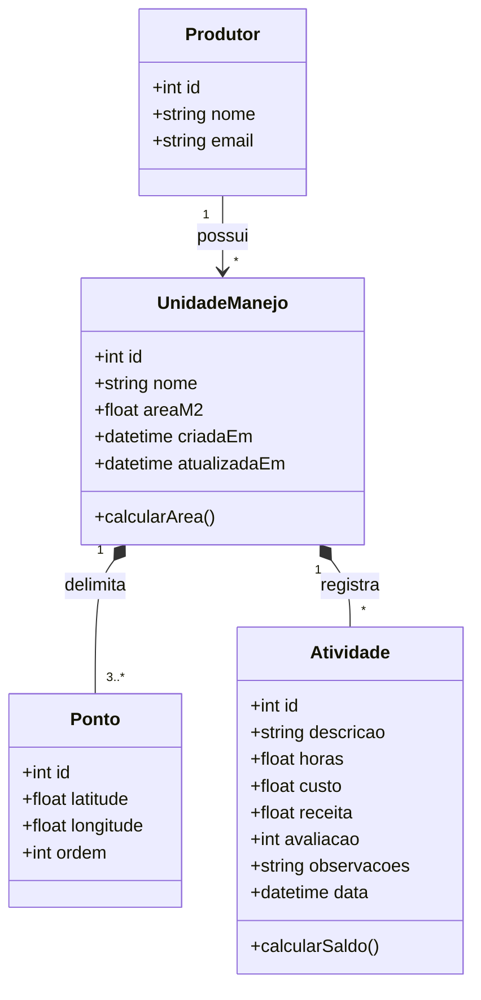
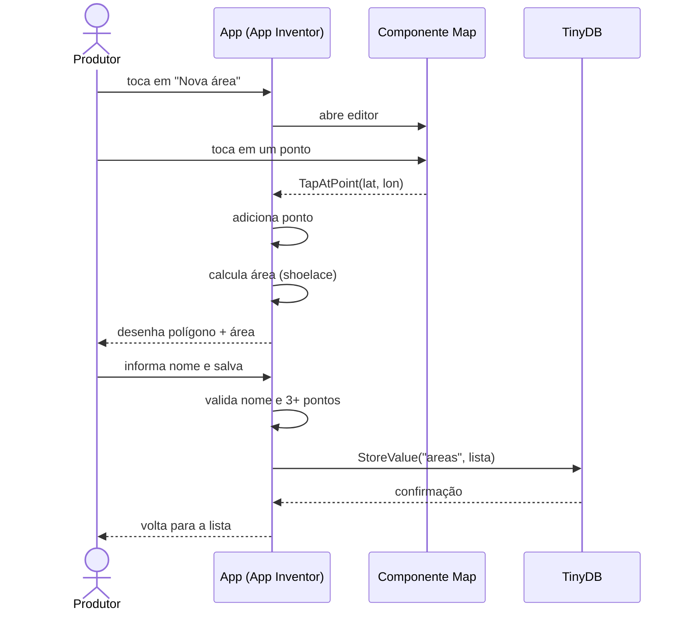
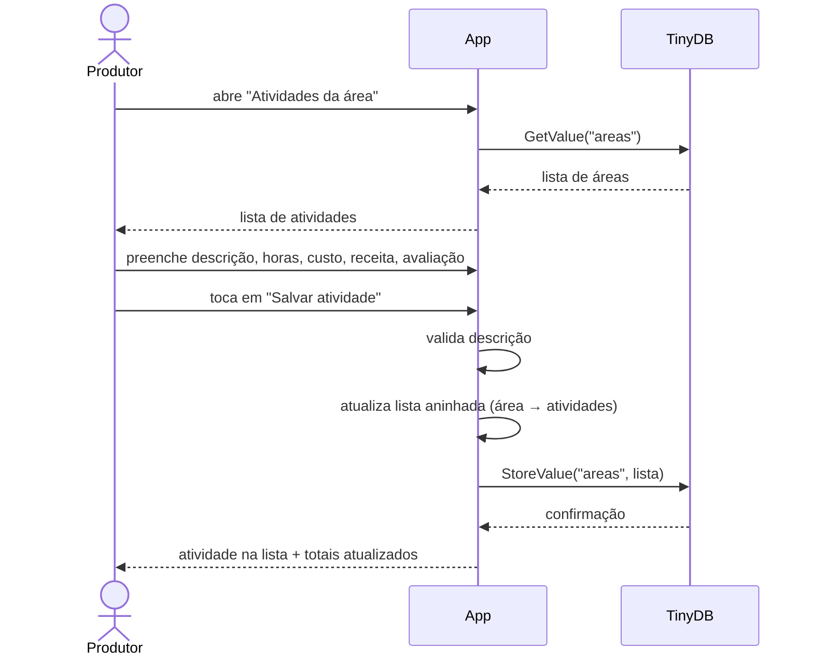
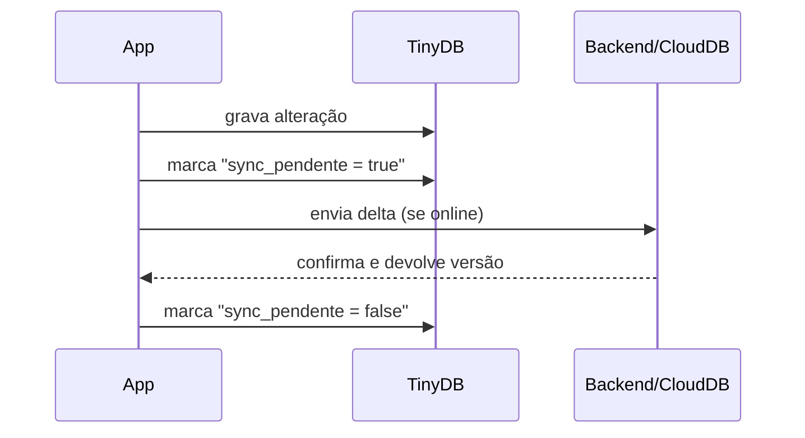
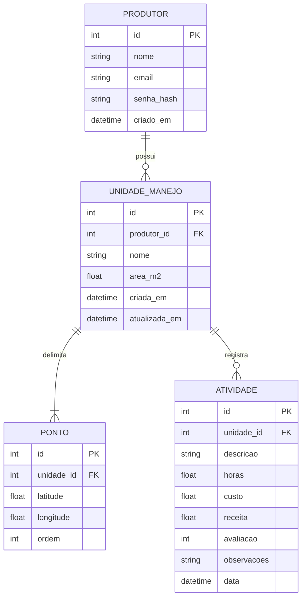

# Entrega, diagramas e relatório

Este documento liga o protótipo ao que o enunciado pede na **entrega básica** (documentos) e na **entrega avançada** (MVP). Os diagramas são modelos iniciais: ajuste nomes e detalhes ao seu projeto.

---

## 1. O que o enunciado pede

**Entrega básica:**

- descrição do software;
- definição dos requisitos;
- casos de uso;
- diagrama de classes;
- diagramas de sequência;
- modelo ER;
- relatório com tecnologias, justificativas e explicação de como a solução atende à demanda.

**Entrega avançada:**

- protótipo funcional (MVP) com os requisitos essenciais.

---

## 2. Requisitos sugeridos

### 2.1 Requisitos funcionais

| Código | Requisito |
|---|---|
| RF01 | Permitir cadastrar uma unidade de manejo com nome e 3 ou mais pontos. |
| RF02 | Permitir informar coordenadas por toque no mapa. |
| RF03 | Permitir informar coordenadas manualmente. |
| RF04 | Permitir obter coordenadas por GPS. |
| RF05 | Calcular a área do polígono formado pelos pontos. |
| RF06 | Exibir o polígono e a área em um mapa. |
| RF07 | Listar, editar e excluir unidades de manejo. |
| RF08 | Registrar atividades em uma unidade de manejo. |
| RF09 | Armazenar descrição, tempo estimado, custo e receita da atividade. |
| RF10 | Permitir avaliar a atividade como positiva, neutra ou negativa, com observações. |
| RF11 | Listar, editar e excluir atividades. |
| RF12 | Calcular totais de custo, receita e saldo por área. |
| RF13 | Persistir os dados localmente (offline). |
| RF14 | Sincronizar os dados quando houver conectividade. |

### 2.2 Requisitos não funcionais

| Código | Requisito |
|---|---|
| RNF01 | Interface simples e intuitiva para uso no campo. |
| RNF02 | Funcionar offline para as operações de cadastro e consulta. |
| RNF03 | Ser eficiente no uso de bateria (GPS com intervalos, sem polling). |
| RNF04 | Ser eficiente no uso de rede (sincronização em lote). |
| RNF05 | Ser escalável para múltiplos produtores e áreas. |
| RNF06 | Garantir integridade dos dados em caso de fechamento do app. |
| RNF07 | Ser compatível com Android (via App Inventor). |

> O RNF05 é **parcialmente atendido** pelo MVP. O relatório deve explicar a arquitetura necessária para atendê-lo de verdade (backend, autenticação, versionamento).

---

## 3. Casos de uso

**Atores:** Produtor rural (usuário principal), Sistema de mapas (externo), Serviço de sincronização (externo).

| Código | Caso de uso | Ator | Descrição |
|---|---|---|---|
| UC01 | Definir área de manejo | Produtor | Marca 3+ pontos, visualiza o polígono e salva a área. |
| UC02 | Usar GPS para marcar ponto | Produtor | Obtém a localização atual e adiciona como vértice. |
| UC03 | Inserir coordenada manual | Produtor | Digita latitude/longitude e adiciona o vértice. |
| UC04 | Editar área | Produtor | Altera nome, pontos ou remove a área. |
| UC05 | Registrar atividade | Produtor | Informa descrição, tempo, custo, receita e avaliação. |
| UC06 | Editar/excluir atividade | Produtor | Altera ou remove uma atividade existente. |
| UC07 | Consultar totais | Produtor | Visualiza custo, receita e saldo da área. |
| UC08 | Sincronizar dados | Sistema | Envia dados locais e recebe dados remotos quando há internet. |

### 3.1 Caso de uso detalhado — UC01 (Definir área)

- **Pré-condição:** app aberto, mapa disponível.
- **Fluxo principal:**
  1. Produtor toca em “Nova área”.
  2. App abre o editor com o mapa.
  3. Produtor toca em 3 ou mais pontos (ou usa GPS/coordenadas manuais).
  4. App desenha o polígono e calcula a área.
  5. Produtor informa o nome e toca em “Salvar”.
  6. App valida (nome e 3+ pontos), grava no TinyDB e volta para a lista.
- **Fluxos alternativos:**
  - menos de 3 pontos → app alerta e não salva;
  - nome vazio → app alerta;
  - GPS sem precisão → app avisa e sugere aguardar.
- **Pós-condição:** área disponível na lista.

---

## 4. Diagrama de classes



> No MVP, `UnidadeManejo` e `Atividade` são listas dentro do TinyDB, não classes Java. O diagrama representa o **modelo conceitual**, que é o que a disciplina pede.

---

## 5. Diagrama de sequência — definir área



---

## 6. Diagrama de sequência — registrar atividade



---

## 7. Diagrama de sequência — sincronização (versão futura)



---

## 8. Modelo ER

Versão conceitual para um backend relacional:



### 8.1 Versão do MVP (TinyDB)

No MVP não há tabelas. O equivalente é:

```text
areas = [
  [ nome, pontos, areaM2, atividades ]
]

pontos = [ [lat, lon], ... ]

atividades = [
  [ descricao, horas, custo, receita, avaliacao, observacoes, data ]
]
```

O relatório pode mostrar as duas versões: o modelo ER “de produção” e o modelo simplificado do protótipo.

---

## 9. Roteiro do relatório

1. **Introdução** — problema, objetivo, público-alvo.
2. **Requisitos** — RF/RNF, casos de uso.
3. **Tecnologias** — App Inventor, Map/OpenStreetMap, TinyDB, CloudDB, Android.
4. **Arquitetura** — telas, fluxo, armazenamento local e remoto.
5. **Modelagem** — classes, sequência, ER.
6. **Implementação** — telas, componentes, blocos principais, fórmula da área.
7. **Testes** — checklist, resultados, limitações encontradas.
8. **Eficiência** — bateria, armazenamento, rede, processamento.
9. **Escalabilidade** — o que o MVP não cobre e como evoluir.
10. **Conclusão** — o que foi validado e próximos passos.
11. **Referências**.

---

## 10. Justificativas para o relatório

### Por que App Inventor?

- prototipagem rápida e sem configuração de build;
- componentes nativos de mapa, polígono, GPS e armazenamento;
- adequado para validar o fluxo com produtores e para a entrega da disciplina;
- limitação: menos controle de performance e arquitetura do que Android nativo/Kotlin.

### Por que TinyDB?

- funciona offline;
- simples de usar;
- persiste entre execuções;
- limitação: local ao dispositivo, sem consultas e sem multiusuário.

### Por que CloudDB (e não Firebase)?

- é o caminho mais curto no App Inventor para demonstrar sincronização;
- limitação: chave-valor, sem autenticação real, sem consultas e com conflitos last-write-wins;
- para produção, Firebase Firestore ou um backend com PostGIS seria mais adequado.

### Por que a fórmula shoelace com projeção local?

- é simples de implementar em blocos;
- tem erro desprezível para áreas rurais pequenas;
- para áreas muito grandes ou próximas dos polos, seria melhor uma fórmula esférica/geodésica.

### Como o app atende à eficiência?

- GPS com intervalos de 60 s/10 m;
- gravação no TinyDB só ao salvar;
- sincronização em lote;
- cálculo de área O(n) com n pequeno;
- mapa com zoom moderado.

---

## 11. Roteiro de demonstração (5–8 minutos)

1. Abrir o app e mostrar a lista vazia.
2. Criar uma área tocando em 4 pontos no mapa.
3. Mostrar o polígono e a área em hectares.
4. Salvar e voltar para a lista.
5. Abrir a área e entrar em “Atividades”.
6. Cadastrar duas atividades com custos e receitas diferentes.
7. Mostrar os totais e o saldo.
8. Editar uma atividade e mostrar o recálculo.
9. Voltar, salvar a área e reabrir as atividades (persistência).
10. Se houver tempo: desligar a internet, mostrar que o app continua; religar e sincronizar.
11. Mostrar rapidamente os diagramas e o relatório.

---

## 12. Ligação entre requisitos e MVP

| Requisito | Onde está no MVP | Status |
|---|---|---|
| RF01 — cadastrar área com 3+ pontos | Screen2 | ✅ |
| RF02 — toque no mapa | `Map.TapAtPoint` | ✅ |
| RF03 — coordenadas manuais | TextBoxLat/Lon | ✅ (Etapa 5) |
| RF04 — GPS | LocationSensor | ✅ (Etapa 5) |
| RF05 — calcular área | `calcularAreaM2` | ✅ |
| RF06 — exibir polígono | Polygon | ✅ |
| RF07 — CRUD de áreas | Screen1/Screen2 | ✅ |
| RF08 — registrar atividades | Screen3 | ✅ |
| RF09 — custo/receita/tempo | Screen3 | ✅ |
| RF10 — avaliação/observações | Spinner + TextBox | ✅ |
| RF11 — CRUD de atividades | Screen3 | ✅ |
| RF12 — totais | `atualizarTotais` | ✅ |
| RF13 — offline | TinyDB | ✅ |
| RF14 — sincronização | CloudDB | ⚠️ parcial |
| RNF05 — escala global | backend futuro | ❌ no MVP |
| RNF03 — bateria | intervalos de GPS | ✅ parcial |
