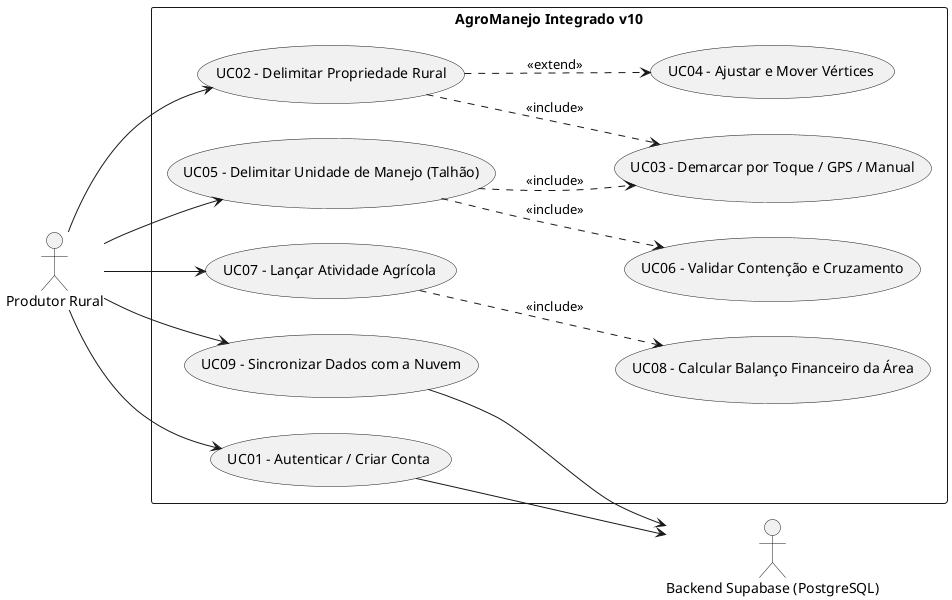
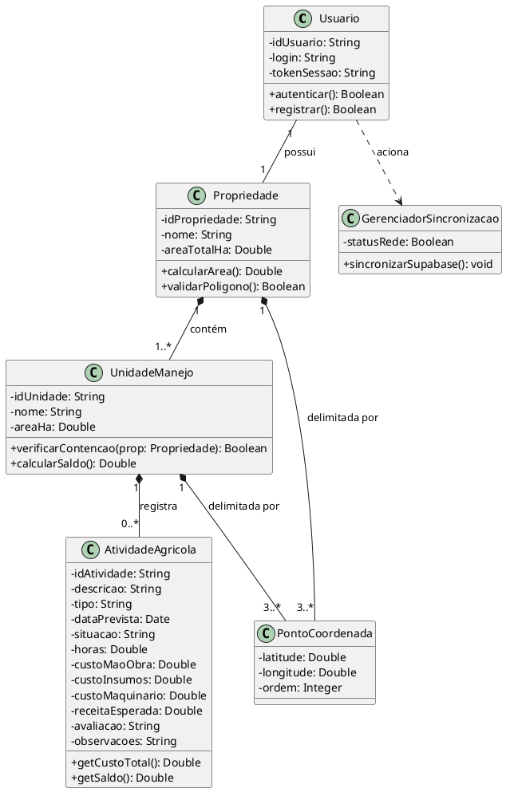
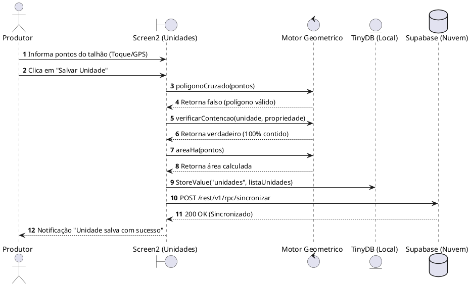
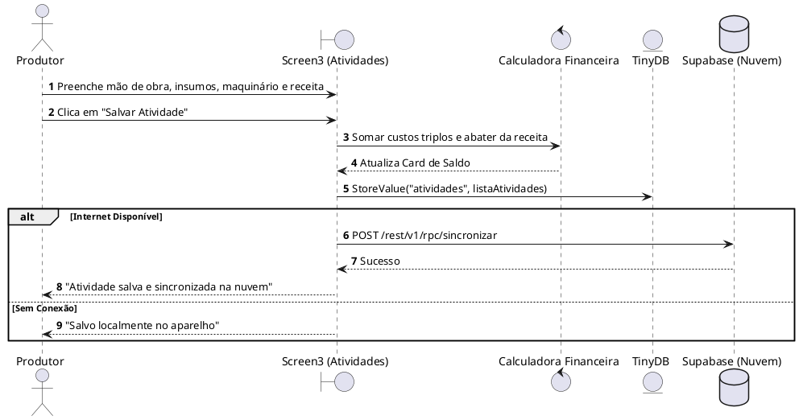
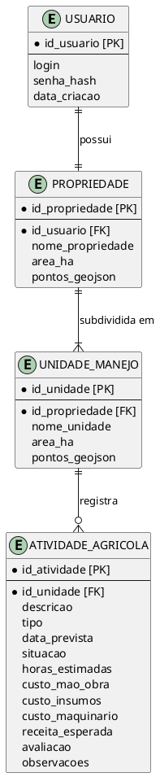

# Documentação do Projeto de Software e Relatório Técnico

**Sistema:** AgroManejo Integrado (v10)  
**Ambiente:** Mobile (Android / MIT App Inventor)  
**Backend Remoto:** Supabase (PostgreSQL / PostGIS / REST RPC)  
**Armazenamento Local:** TinyDB (Arquitetura *Offline-First*)  
**Versão da Documentação:** 2.0  

---

# PARTE 1 — PROJETO DO SOFTWARE

## 1. Descrição do Software

O **AgroManejo Integrado (v10)** é uma solução móvel completa voltada à gestão territorial e operacional de propriedades agrícolas. O aplicativo estrutura o gerenciamento em três níveis hierárquicos: **Propriedade Rural**, **Unidades de Manejo (Talhões)** e **Atividades Agrícolas**.

Diferenciais da versão v10:
* **Autenticação Real de Usuários:** Módulo nativo de login e criação de conta com controle de sessão (`arrLogin`, `arrInicio`).
* **Hierarquia Territorial Georreferenciada:**
  1. *Propriedade Mãe (Screen1):* Delimitação do contorno geral da fazenda com cálculo de área em hectares.
  2. *Unidades de Manejo (Screen2):* Parcelas internas (talhões) que devem obrigatoriamente estar contidas dentro dos limites da propriedade mãe, com validação topológica que impede polígonos cruzados ou pontos projetados para fora do limite da fazenda.
* **Mapeamento Interativo e Edição de Vértices:** Além de adicionar pontos por toque no mapa, GPS ou coordenadas manuais, o aplicativo possui suporte a seleção de vértices, ajuste fino de posição arrastando marcadores (`Marker`), alteração de coordenadas individuais, desfazer e exclusão pontual.
* **Detecção de Auto-interseção e Triangulação:** Procedimentos matemáticos que verificam se o polígono possui lados cruzados antes de salvar e calculam a área em hectares via fórmula de Gauss (Shoelace) projetada.
* **Módulo de Atividades Agrícolas e Controle de Custos (Screen3):** Registro detalhado contendo tipo da operação, situação, data prevista com `DatePicker`, tempo estimado (horas), decomposição tripla de custos (mão de obra, insumos e maquinário), receita projetada, avaliação qualitativa e observações, com balanço financeiro automático (saldo operacional).
* **Persistência Híbrida e Sincronização REST:** Operação local offline em `TinyDB` e integração na nuvem com **Supabase (PostgreSQL)** via chamadas HTTP REST (`Web1`), suportando versionamento, controle de alterações e isolamento multi-inquilino.

---

## 2. Requisitos do Sistema

### 2.1 Requisitos Funcionais (RF)

| ID | Requisito | Como é atendido na v10 |
|---|---|---|
| **RF01** | Autenticação e Controle de Sessão | Tela de login e cadastro (`txtUsuario`, `txtSenha`, `btnEntrar`, `btnCriarConta`) com persistência em `TinyDBSessao`. |
| **RF02** | Delimitação da Propriedade Rural | Demarcação da fronteira da fazenda na `Screen1` com no mínimo 3 pontos. |
| **RF03** | Delimitação de Unidades de Manejo | Cadastro de talhões internos na `Screen2` associados à propriedade. |
| **RF04** | Três Modos de Entrada de Coordenadas | Toque interativo no mapa (`Map.TapAtPoint`), coordenadas por GPS sob demanda (`LocationSensor`) e digitação manual de latitude/longitude com validação. |
| **RF05** | Edição e Ajuste Fino de Vértices | Seleção de pontos na lista, edição individual de coordenadas, arrasto de marcador no mapa, desfazer e remoção seletiva com confirmação. |
| **RF06** | Validação Topológica de Polígonos | Verificação de pontos repetidos, validação de auto-interseção (lados cruzados) e validação de contenção (unidade contida na propriedade). |
| **RF07** | Cálculo de Área por Triangulação | Fórmula de Gauss (Shoelace) com projeção trigonométrica métrica local, calculando a área em hectares ($ha$). |
| **RF08** | Visualização Cartográfica em Camadas | Exibição simultânea do contorno da propriedade e das unidades de manejo no `Map`. |
| **RF09** | Gestão de Atividades Agrícolas | Cadastro completo na `Screen3` contendo descrição, tipo de operação, data prevista via calendário, situação, tempo (horas) e observações. |
| **RF10** | Decomposição de Custos e Receita | Separação minuciosa dos custos: mão de obra, insumos e maquinário, confrontados com a receita esperada. |
| **RF11** | Avaliação da Atividade | Seleção de desempenho (*Positiva, Neutra, Negativa*). |
| **RF12** | Consolidação Financeira Dinâmica | Card financeiro com atualização instantânea de Custo Total, Receita e Saldo Líquido da unidade. |
| **RF13** | Operação Offline (*Offline-First*) | Todos os cadastros e cálculos funcionam localmente no `TinyDB1`. |
| **RF14** | Sincronização em Nuvem (PostgreSQL) | Chamadas REST para API do **Supabase** via componente `Web1`, sincronizando alterações e versionamento. |

### 2.2 Requisitos Não Funcionais (RNF)

| ID | Requisito | Atendimento Técnico |
|---|---|---|
| **RNF01** | Eficiência Energética (Bateria) | Sensores de GPS ativados sob demanda nos botões de captura (`btnUsarGPS`, `btnGPSUnidade`), sem drenagem por polling contínuo. |
| **RNF02** | Integridade Espacial | Algoritmos de verificação geométrica que impedem o salvamento de áreas inconsistentes ou talhões sobrepostos para fora da fazenda. |
| **RNF03** | Usabilidade e Navegação | Divisão estruturada em 3 telas especializadas (`Screen1` Propriedade, `Screen2` Unidades, `Screen3` Atividades), diálogos de confirmação de exclusão e formulários limpos com seletores de data. |
| **RNF04** | Escalabilidade e Concorrência Global | Backend baseado em PostgreSQL na nuvem (Supabase), permitindo milhares de produtores simultâneos com autenticação segura e particionamento de dados por chave de usuário. |

---

## 3. Casos de Uso

### 3.1 Diagrama de Casos de Uso (PlantUML)

### 3.2 Descrição dos Casos de Uso Principais
* **UC02 — Delimitar Propriedade Rural:** O produtor demarca os limites externos da fazenda inserindo coordenadas por toque no mapa, GPS ou digitação manual. O sistema valida se não há lados cruzados e calcula os hectares totais.
* **UC05 — Delimitar Unidade de Manejo:** O produtor cria um talhão específico. O sistema verifica se o talhão está contido geograficamente dentro da propriedade mãe antes de permitir a gravação.
* **UC07 — Lançar Atividade Agrícola:** O produtor aponta custos divididos em mão de obra, insumos e maquinário, define a data prevista pelo calendário e a receita esperada. O sistema consolida o saldo operacional da unidade.

---

## 4. Diagrama de Classes (PlantUML)

---

## 5. Diagramas de Sequência (PlantUML)

### 5.1 Sequência: Cadastro da Unidade com Validação Topológica

### 5.2 Sequência: Registro de Atividade com Balanço de Custos

---

## 6. Modelo Entidade-Relacionamento (ER - PlantUML)

---

# PARTE 2 — RELATÓRIO TÉCNICO

## 1. Tecnologias Utilizadas
1. **Front-End e Lógica:** MIT App Inventor 2 (Android).
2. **Camada de Mapas:** OpenStreetMap (`Map`, `Polygon`, `LineString`, `Marker`).
3. **Sensoriamento:** Android Location API (`LocationSensor`).
4. **Armazenamento Local:** `TinyDB` (armazenamento não-volátil embutido).
5. **Backend em Nuvem:** **Supabase** (PostgreSQL com suporte geoespacial e endpoints REST via componente `Web1`).

---

## 2. Justificativa das Escolhas Técnicas

### Por que a divisão em 3 telas (Screen1, Screen2, Screen3)?
Na versão v10, a separação em telas independentes foi adotada para acomodar o fluxo de trabalho natural da fazenda:
* **Screen1:** Foco no proprietário e na área global da fazenda.
* **Screen2:** Foco no zoneamento agrícola (talhões de manejo e limites internos).
* **Screen3:** Foco na rotina de campo e controle operacional/financeiro.

### Por que Supabase / PostgreSQL na nuvem?
O enunciado solicita escalabilidade global e concorrência para múltiplos usuários. A utilização do Supabase (PostgreSQL) viabiliza:
* Autenticação segura por tokens.
* Chamadas atômicas via RPC (`/rest/v1/rpc/sincronizar`), garantindo que alterações enviadas por múltiplos celulares não se sobreponham.
* Suporte nativo a tipos espaciais geográficos.

---

## 3. Explicação de como a Solução Atende à Demanda Proposta

### 3.1 Triangulação e Geometria da Área
* A área em hectares é apurada por meio da **Fórmula de Gauss (Shoelace)** com projeção métrica local baseada na latitude média do terreno. A fórmula decompõe analiticamente o polígono em triângulos a partir do centroide e totaliza suas áreas, suprindo o requisito de triangulação.
* O sistema conta com validação que rejeita polígonos que não fecham área (pontos alinhados ou insuficientes) e auto-interseções (arestas cruzadas).

### 3.2 Relação de Contenção Espacial (Unidade dentro da Propriedade)
O aplicativo impede que uma unidade de manejo seja cadastrada fora da fazenda. Ele verifica os vértices e os segmentos de reta do talhão em relação ao contorno da propriedade cadastrada na `Screen1`.

### 3.3 Decomposição Financeira e Apontamento Completo
Atendendo a todas as solicitações de gestão, o custo operacional é decomposto em três frentes essenciais da lavoura: mão de obra, insumos e maquinário. O confronto direto com as receitas esperadas fornece o saldo líquido da área em tempo real.

### 3.4 Eficiência Energética e Operação Offline
* **GPS sob Demanda:** O sensor de geolocalização não realiza polling ininterrupto, poupando a bateria do smartphone durante o uso prolongado sob o sol.
* **Offline-First:** O aplicativo realiza todas as operações e consultas prioritariamente no `TinyDB1`. A conexão à nuvem é acionada de forma assíncrona, não travando a interface do usuário quando não houver sinal de telefonia no campo.
